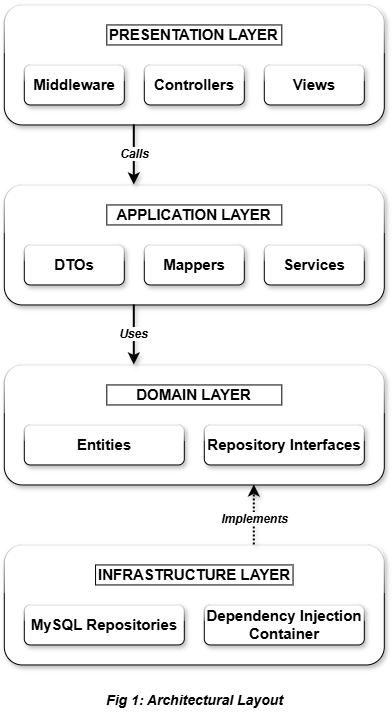
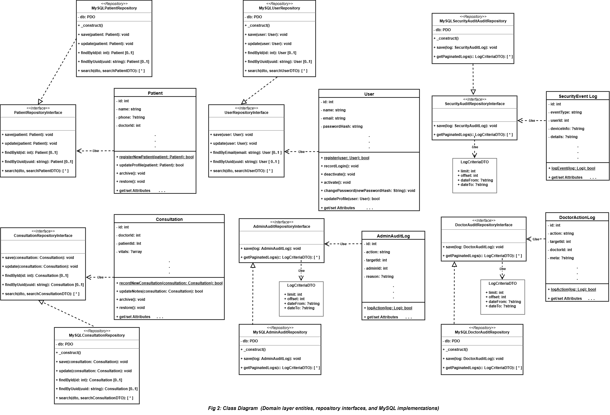
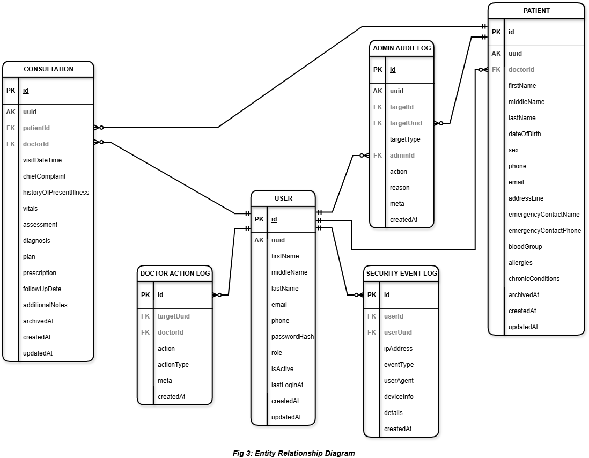
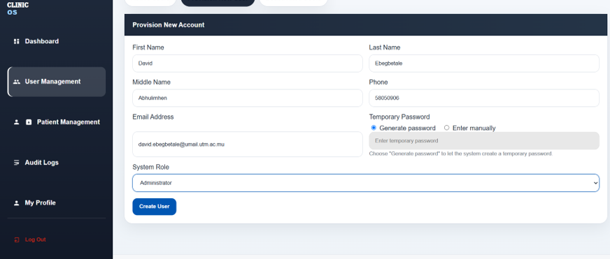
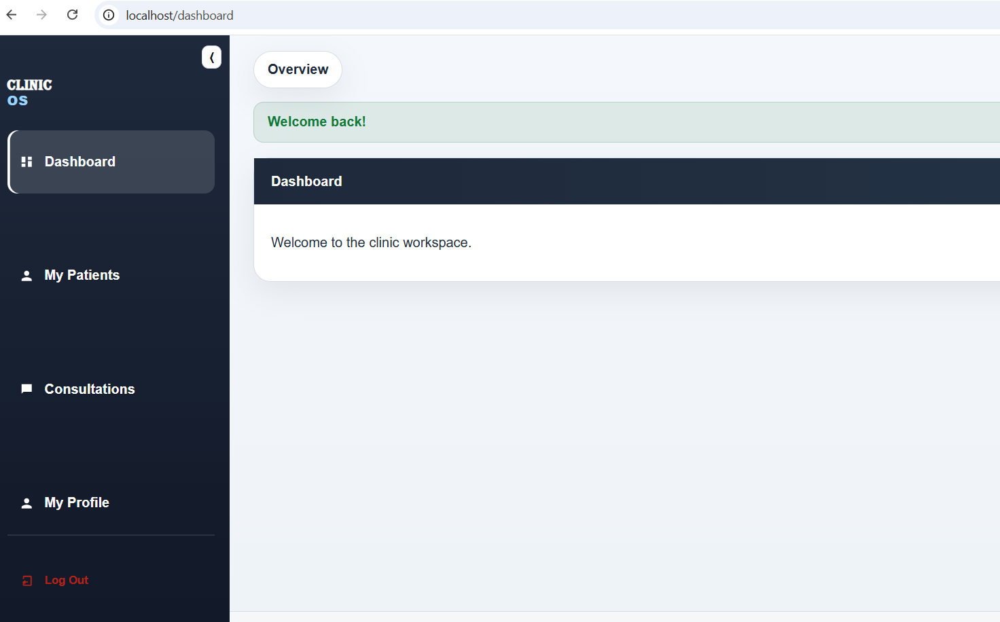

# Clinic Management System

**About:**
A secure, role-based clinic management platform with an integrated EHR, audit trail, and archival sub-systems. The software is architected as a custom four-tier Domain-Driven Design application in PHP, targeted at small-to-medium healthcare facilities, including already-digitalized institutions needing an upgrade, and those still reliant on manual, paper-based record keeping.

## Table of Contents

- [Overview](#overview)
- [Objectives](#objectives)
- [System Architecture](#system-architecture)
- [Database Design](#database-design)
- [Secutity &amp; Middleware / Interceptors](#security--middleware-interceptors)
- [Auditing &amp; Data Management](#auditing--data-management)
- [User Interfaces](#user-interfaces)
- [Tech Stack](#tech-stack)
- [Getting Started](#getting-started)
- [Documentation](#documentation)
- [Author &amp; Contact](#author--contact)
- [License](#license)

## Overview

Small-to-medium healthcare facilities that still rely on paper-based records face real exposures and vulnerabilities including no tamper-proofing, slow retrieval of patient details and health records, and difficulty meeting data retention and protection obligations. This project digitizes the consultation workflow while closing gaps common in existing EHR/EMR platforms, which often function as simple CRUD wrappers with a single flat permission model.

This system separates administrative oversight from clinical operations, implementing a Principle of Least Privilege (PLP) access model that preserves the confidentiality of health records, such that each practitioner can record and view consultations only for their own active patients while administrators can access system wide records through logged, high level privileges.  The design is informed by the security-of-processing principles set out in Mauritius's Data Protection Act 2017, which is itself modeled on the EU's General Data Protection Regulation (GDPR).

## Objectives

The project was implemented to achieve the following objectives:

- **Structured consultation recording** of clinical encounters.
- **Segregation of Duties (SoD)** by incorporating a role-based authentication module that demarcates high-privilege administrative tasks from clinical workflows.
- **Immutable data retention** that employs a logical soft-deletion strategy with timestamp and metadata tracking, to satisfy medical record retention and audit standards.
- **Confidentiality-preserving oversight** by enforcing the Principle of Least Privilege.
- **Standardised document export** through an automated pipeline that exports consultation records as tamper-evident PDF reports for both hard-copy and external use
- **Hardened security** using a custom Dependency Injection (DI) container and error-suppression layer that prevents raw stack traces from reaching the client

## System Architecture



This application is engineered as a custom **Four-Tier Domain-Driven Design (DDD)** platform in PHP, intentionally developed without a monolithic third-party framework. Given the sensitive nature of its sub-systems, this frameworkless approach ensures architectural autonomy, tight control over security boundaries, and a strict isolation of domain components.



Bypassing rigid third-party architectural constraints ensures the codebase avoids leaking framework infrastructure into core domain logic. The system also leverages Composer for dependency management and PSR-4 autoloading to support dependecy injection and establish a standardized, decoupled subsystem layout.

| Layer                    | Responsibility                                                                      |
| ------------------------ | ----------------------------------------------------------------------------------- |
| **Presentation**   | Middleware intercepts HTTP requests before they reach a controller                  |
| **Application**    | Services and DTOs orchestrate business use cases                                    |
| **Domain**         | Core business entities and abstract repository interfaces                           |
| **Infrastructure** | MySQL persistence and DI container resolution, implementing the domain's interfaces |

## Database Design



***Note: For a deeper dive into the system's behavioral workflows, additional design assets are available in the docs/diagrams directory, including:***

* **Use Case Diagram** mapping system boundaries, user roles, and core interactions.
* **Sequence Diagrams** detailing architectural behavior across specific system flows, including:
  - Write operations
  - Security-sensitive execution paths
  - Compound operations with transactional side effects
  - Export operation involving an external library

## Security & Middlewares / Interceptors

Security is enforced primarily through a chain of middleware intercepting every request before it reaches a controller. AuthMiddleware verifies an active session, AdminMiddleware restricts administrative routes to the Administrator role (enforcing the Segregation of Duties above), CsrfMiddleware validates a token on every state-changing request to protect against cross-site request forgery, and SessionTimeoutMiddleware terminates a user session after a predefined period of inactivity. Input sanitization is also handled at the middleware layer, before a request ever reaches a controller.

Concurrently, Application Services enforce structural validation, state rules, and domain invariants before any persistence routines are executed, example: RecordConsultationService performs an authorization check before persisting a new consultation, confirming the practitioner is actually assigned to the patient in question.

At the Infrastructure layer, database access goes through PHP's PDO extension, with PDOConnection implemented as a Singleton. SQL injection and related backend data-tier vulnerabilities are neutralized during data retrieval using parameterized prepared statements while the database rows are securely hydrated into isolated domain entities, ensuring database schema footprints never expose or couple themselves to the inner core logic.

## Auditing & Data Management

The system uses a Multi-Vector Auditing Strategy which is distinct, scenario-specific trails instead of a single generic log.

- **Clinical Audit Trail** traces every clinical interaction (diagnosis, prescription updates) to the practitioner who performed it
- **Security Event Log** captures session metadata (IP address, timestamp, device signature) to establish a reliable trail of system access, including access from unrecognised devices
- **Administrative Audit Log** tracks user provisioning and revocation, admin and lower-privilege user actions, audit-view access, and global record lifecycle events via polymorphic associations

## User Interfaces


*Administrative GUI*


*Practitioner's Dashboard*

## Tech Stack

- **Language:** PHP 8.5.0 (strict typing)
- **Database:** MySQL 8.0.42
- **Dependency Manager:** Composer 2.9.7
- **Frontend:** HTML5, CSS3, Vanilla JavaScript

## Getting Started

1. Clone the repository

   ```bash
   git clone https://github.com/{your-username}/{repo-name}.git
   cd {repo-name}
   ```
2. Install dependencies

   ```bash
   composer install
   ```
3. Initialize the database schema
   Import `sql/schema.sql` into a local MySQL instance using your preferred tool (phpMyAdmin, MySQL Workbench, or the CLI).
4. Configure the environment

   ```bash
   cp .env.example .env
   ```

   Then open `.env` and update the database configuration and security credentials to match your local environment.

## Documentation

This README provides a high-level architectural overview of the system. The comprehensive Technical Report and Engineering Documentation detailing the project's background research, core engineering novelty, system requirements, and full test validation results is available upon request.

## Author & Contact

**Project Lead & Software Architect:** David Abhulimhen Ebegbetale

If you are a recruiter, academic reviewer, or collaborator interested in evaluating the full technical brief or discussing the underlying research, reach out via:
[LinkedIn](https://www.linkedin.com/in/da-ebegbetale)

## License

This project is proprietary and confidential to the extent stated in [LICENSE](./LICENSE). The repository is public for portfolio review, academic evaluation, and architectural reference only. Refer to the license file for full terms.
